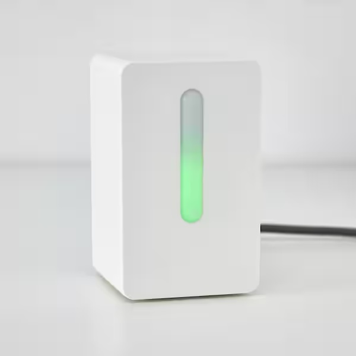
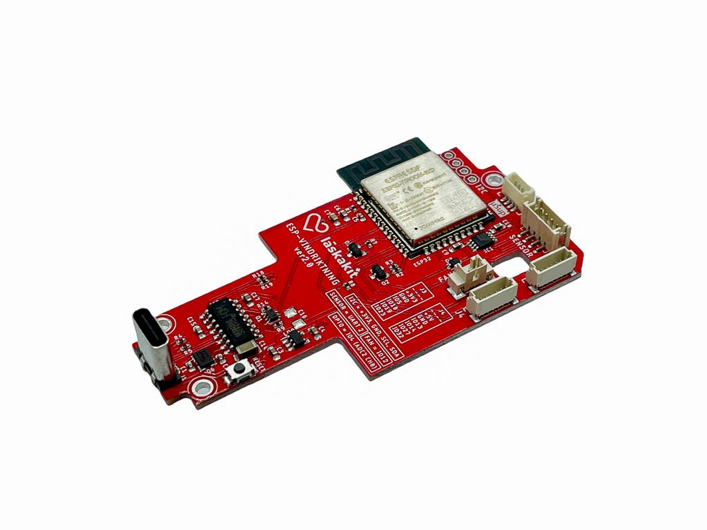

<div align="center">
<h1> ESP (Ikea) Vindriktning & Rust 🦀</h1>

Upgraded Ikea Vindriktning with ESP32

  

&plus;

  
</div>

### Basic features

- Air quality monitoring (PM2.5 + CO2)
- Smart LEDs for displaying results
- Simple HTTP server (over WiFi), see [REST API](#rest-api)
- Night mode (dimmed LEDs at night)
- Optional remote data logging

## Lifecycle

1. turn on the fan for 10 seconds to get fresh air
2. measure CO2 & PM2.5 (PM2.5 is read 6× 1 s apart, the median filters out sporadic spikes)
3. sleep for 50 seconds
4. repeat

## LEDs

Top LED shows CO2, bottom LED PM2.5, center LED a mix of both.

| Color | CO2 (ppm) | PM2.5 (µg/m³) |
|---|---|---|
| 🩵 aqua `#00FFFF` | ≤ 400 | – |
| 🟢 green `#00FF00` | ≤ 1000 | ≤ 12 |
| 🟡 yellow `#FFFF00` | ≤ 1500 | ≤ 35 |
| 🟠 orange `#FF4500` | ≤ 2000 | ≤ 55 |
| 🔴 red `#FF0000` | > 2000 | ≤ 150 |
| 🟤 dark red `#800000` | – | > 150 |

Night mode: once the clock is synced over NTP, brightness is 1 between 22:00 and 6:00 and 20 otherwise.

### Status and errors

**Blinking (✨) always means something needs attention.** Blue is used only for errors.

| LEDs | Meaning |
|---|---|
| 🟣🟣🟣 all magenta `#FF00FF` | booting / connecting to WiFi |
| ⚪⚪⚪ all white `#FFFFFF` | waiting for the first reading |
| ✨ top/bottom blinking in its color | 2–4 failed reads in a row, showing the last good value |
| ✨🔵 top/bottom blinking blue `#0000FF` | 5+ failed reads in a row (~5 min), sensor needs attention |
| ✨ center blinking | WiFi disconnected or clock never synced |
| ✨🔵🔵🔵 all blinking blue | both sensors failed |

A single failed read is ignored. Blinking LEDs stay visible in night mode. `GET /data` also returns `co2_status` / `pm25_status` with `failures` (consecutive) and `health` (`waiting`, `ok`, `stale`, `failed`).

## REST API

The device runs an HTTP server on port 80; find its IP in your router or in the serial log.

### `GET /data`

Last measured values, recent history and sensor health.

```sh
curl http://<device-ip>/data
```

```json
{
  "co2": 812,
  "pm25": 6,
  "timestamp": "2026-10-12T18:00:00+02:00",
  "history": [
    { "co2": 805, "pm25": 6, "timestamp": "2026-10-12T17:59:00+02:00" },
    { "co2": 812, "pm25": null, "timestamp": "2026-10-12T18:00:00+02:00" }
  ],
  "co2_status": { "failures": 0, "health": "ok" },
  "pm25_status": { "failures": 1, "health": "ok" }
}
```

| Field | Description |
|---|---|
| `co2`, `pm25` | last successfully read values (ppm, µg/m³) |
| `timestamp` | time of the last successful read (RFC 3339), `null` until the first one |
| `history` | last 5 measurements, oldest first; a failed sensor read is `null` |
| `*_status.failures` | consecutive failed reads |
| `*_status.health` | `waiting`, `ok`, `stale` (2+ failures) or `failed` (5+ failures) |

### `PUT /brightness`

Sets LED brightness (`0`–`255`, JSON number in the body). Once the clock is synced, the night mode schedule (checked every minute) resets it to 20 by day / 1 by night.

```sh
curl -X PUT -H "Content-Type: application/json" -d 20 http://<device-ip>/brightness
```

### `POST /restart`

Restarts the device.

```sh
curl -X POST http://<device-ip>/restart
```

### Remote logging (optional)

When `LOG_URL` and `LOG_API_KEY` are set, every measurement with both values is `POST`ed to `LOG_URL` as `{"co2": 812, "pm25": 6}` with an `apikey` header.

## Components

- IKEA Vindriktning https://www.ikea.com/cz/cs/p/vindriktning-senzor-kvality-vzduchu-80515910/
- ESP32 board https://www.laskakit.cz/laskakit-esp-vindriktning-esp-32-i2c/
- SCD41 CO2 sensor https://www.laskakit.cz/laskakit-scd41-senzor-co2--teploty-a-vlhkosti-vzduchu/

## Development

Built on the Rust `std` ESP-IDF stack: [`esp-idf-svc`](https://github.com/esp-rs/esp-idf-svc) 0.53 (`esp-idf-hal` 0.47, `esp-idf-sys` 0.38) and **ESP-IDF v6.1**. ESP-IDF itself is downloaded and built automatically by `esp-idf-sys` on the first build (into `.embuild/`), the version is set by `ESP_IDF_VERSION` in `.cargo/config.toml`.

1. Install [`espup`](https://github.com/esp-rs/espup#installation), `ldproxy` and `espflash`

```sh
cargo install espup ldproxy espflash cargo-espflash
```

2. Install the Xtensa Rust toolchain (the `esp` channel used by `rust-toolchain.toml`)

```sh
espup install
```

3. Set up the environment variables: `source ~/export-esp.sh`. **This step must be done every time you open a new terminal.**

4. Create `.env` from `.env.example` and fill in your WiFi credentials and timezone. Values are baked into the firmware at build time.

```sh
cp .env.example .env
```

| Variable | Required | Description |
|---|---|---|
| `WIFI_SSID` | yes | WiFi network name (2.4 GHz) |
| `WIFI_PASSWORD` | yes | WiFi password |
| `TIMEZONE` | yes | IANA timezone, e.g. `Europe/Prague` (used for night mode) |
| `LOG_URL` | no | endpoint for remote logging |
| `LOG_API_KEY` | no | sent as `apikey` header to `LOG_URL` |

5. Build

```sh
cargo build --release
```

6. To make this work with `rust-analyzer`, edit `.vscode/settings.json` like this:

```json
  "rust-analyzer.server.extraEnv": {
    "LIBCLANG_PATH": "the same path as in ~/export-esp.sh, has to be absolute"
  },
```

## Flashing

```sh
make flash   # build, flash and open the serial monitor
make monitor # serial monitor only
make bin     # save firmware image to target/firmware.bin
```

## Notes

- binary larger than 1 MB won't flash without `partition.csv` file (1MB is probably a default value)

- `opt-level = "s"` is currenty broken in `rustc 1.65.0` (miscompilation issues)
